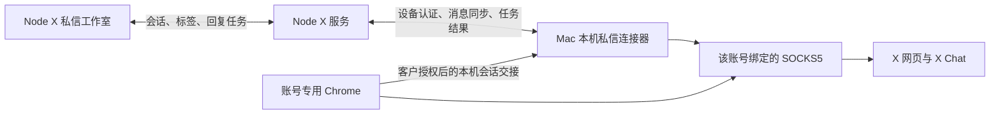

# Node X 批量私信管理开发文档

更新于 2026-11-20

## 1. 目标和交付范围

在 Node X 增加「私信工作室」。客户在账号专用 Chrome 窗口登录 X 后，可以从同一账号连接私信。网页和私信使用账号原有的 SOCKS5 配置。私信通过第三方项目 `mautrix/twitter` 接入，无需 X 官方 API 凭据。

首版提供多账号收件箱、已有会话和文本历史、手动同步、待处理筛选、批量标签、批量标记已处理及重新打开，以及员工确认后的单会话文本回复。「已处理」和标签保存在 Node X。X 上的已读回执由其自身规则决定。

批量操作面向会话整理。同一批会话可以一次打标签或变更处理状态，发送动作按会话确认。员工分配需要独立的员工身份，当前工作台以登录码对应的工作空间为权限边界，首版先提供工作空间内共享的处理状态。

## 2. 运行架构

| 部件 | 职责 |
| --- | --- |
| 本机 Chrome 启动器 | 按工作空间和账号窗口打开隔离 Chrome 配置，继续使用现有代理转发。复用 [窗口配置](server/workspace.ts)、[本机启动器](launcher/native-host.ts) 和 [Chrome 启动逻辑](launcher/chrome.ts)。 |
| 本机私信连接器 | 每个账号独立的 Go 客户端。基于 `mautrix/twitter` 的 `twittermeow`，适配登录、PIN、会话同步、发送和重连。用 macOS Keychain 保存会话及密钥，进程生命周期独立于 Chrome。 |
| Node X 服务 | 校验工作空间、设备和账号绑定。保存经客户同意同步的消息、标签、会话状态及发送任务，沿用工作空间 SQLite 隔离。 |
| 私信工作室 | 展示会话列表、消息详情、连接状态和任务结果。登录凭据在本机组件之间交接。 |

完整 mautrix bridge 需要 Matrix homeserver，可作为技术验证路径。产品方案采用本机 Go 连接器，需把上游与 Matrix 绑定的登录编排、游标和事件处理适配到 Node X 接口。直接引入 `twittermeow` 后仍需实现这些环节。固定上游源码版本并记录对应构建产物，随发布包保留适用的上游许可证文件。

本机连接器运行时，关闭 Chrome 也可继续同步。Mac 睡眠、关机或服务退出时，工作台显示上次同步时间和离线状态。恢复连接后按游标补同步。若需要设备关机后仍收信，另行设计经客户授权的常驻部署及会话存储。

## 3. 登录和账号绑定

上游 X 连接器公开 `cookies` 和 `password` 两条流程。Node X 的「打开 X 登录」及「复用现有登录」可使用同一条会话接入流程。

| 工作台入口 | 客户操作 | 实现说明 |
| --- | --- | --- |
| 打开 X 登录并连接私信 | 选择账号，在专用 Chrome 窗口登录 X，然后确认连接私信。 | 默认入口。会话确认后，本机扩展将对应 Profile 的会话交给本机连接器。 |
| 复用现有登录 | 已登录的客户在该账号窗口里确认连接私信。 | 与默认入口共用 `cookies` 流程。只访问客户授权的 X 网站和对应 Profile。 |
| 账号密码连接 | 在本机登录组件中输入用户名、邮箱或手机号和密码，按提示完成验证。 | 后续备用入口。复用上游 `password` 流程及其 WebView 能力。此会话供私信连接器使用，已有 Chrome 窗口的网页会话由 Chrome 自己维护。 |

1. 工作台从已授权的工作空间取得账号和关联窗口，签发限定用途、短时、一次性的连接凭证。客户在本机确认授权范围。
2. 扩展运行在对应账号的专用 Chrome Profile，将会话通过本机通道交给连接器。现有工作台扩展的权限只有 Native Messaging，需新增账号窗口内的授权与安装流程。正式 Chrome 新版已移除用于加载未打包扩展的命令行标志，测试时应验证拟发布的安装方式。
3. 连接器通过该账号绑定的代理校验会话，取得 X 数字用户 ID。首次绑定时展示识别到的账号并让客户确认。重连时必须与已绑定的 X 用户 ID 一致，账号不符时保留原绑定并提示切换正确的窗口。
4. 上游会在验证会话后进入 X Chat PIN 设置或恢复步骤。本机界面引导客户按提示完成，持久化所需密钥和签名版本。密码、验证码和 PIN 仅在本机登录过程中使用。
5. 绑定成功后，在工作台显示「已连接」并开始同步。会话失效时显示「需重新登录」，等待客户在同一账号窗口恢复会话。解除私信绑定后，停止同步和发送，并清除连接器的本机凭据。

上游 Cookie 导入说明要求先关闭来源浏览器。**浏览器和私信连接器同时长期复用会话是正式上线前的验证项。** 验证不通过时，暂以「打开 X 私信页」提供入口，私信连接器的独立登录作为后续选择。

## 4. SOCKS5 与凭据

- 网页与私信都从 `accountId → profileId → proxyId` 解析代理。各账号独立绑定，连接器使用真实 SOCKS5 上游配置。现有 Chrome 本地转发端口随浏览器关闭，私信同步使用自己的连接。
- X 登录验证、消息和媒体请求、WebSocket、重连及 X Chat 密钥恢复都使用已验证的代理配置。代理不可用或配置缺失时，受影响账号暂停同步和发送。代理更换后，重建该账号的连接，再恢复任务。
- 上游 [代理修复 #241](https://github.com/mautrix/twitter/pull/241) 于 2026-11-19 合并。固定到包含修复的版本，技术验证可用提交 `2efd3a5da34d459f2a75b5140f96b99f41582766`。完整 bridge 的默认代理配置为实例级，本机连接器需要给每个 Go 客户端单独绑定代理，并显式拒绝空代理配置。 [客户端代理源码](https://github.com/mautrix/twitter/blob/2efd3a5da34d459f2a75b5140f96b99f41582766/pkg/twittermeow/client.go#L197-L216)
- 同一条 SOCKS5 配置能复用；如果还要求网页和私信呈现相同的实际出口 IP，代理服务须提供固定出口或同一粘性会话。设备与 Node X 服务的管理连接使用 TLS。
- X 密码、会话 Cookie、X Chat 密钥、验证码及 PIN 仅由本机组件处理。代理密码沿用受限的本机配置接口下发。工作台网页、私信业务接口及日志均不接收这些凭据。服务器同步和保存哪些消息数据，由客户在启用时确认。只有授权有效的工作空间成员才能读消息。

## 5. 收件箱与批量处理

1. 收件箱默认显示已连接账号的全部会话，可按账号、标签、处理状态和最近活动筛选。每条显示来源账号、会话参与者、最后消息摘要及时间。
2. 支持逐项勾选和全选当前页。工具栏显示已选数量，可批量添加或移除标签、标记已处理及重新打开。切换筛选条件时清空所选项。
3. 批量请求提交明确的会话 ID 和目标操作。服务端验证整个批次在当前工作空间内再更新。重复提交同一目标状态返回实际更新数和已符合状态的数量。
4. 会话详情按时间显示入站和出站消息。新入站消息可把已处理会话重新移入待处理，重复事件和历史回补保留当前人工处理状态。
5. 回复区显示将用于发送的 X 账号。客户确认后创建任务。连接不可用时显示明确原因。账号状态区显示在线、离线、代理异常、需重新登录及最近成功同步时间。

## 6. 接口和数据模型

以下路由与表名供开发使用。工作台路由挂入现有 `requireAuth`，由登录会话确定工作空间。后台连接器通过配对获得可撤销的设备凭据。服务端以凭据确定工作空间、设备及可操作账号范围，并在领取任务和提交结果时再次检查授权。

| 路由 | 请求或返回 |
| --- | --- |
| `POST /api/dm/accounts/:id/connect-ticket` | 签发一次性本机连接凭证，绑定账号、对应窗口和当前授权。 |
| `GET /api/dm/accounts` | 返回已绑定的 X 用户 ID、连接状态、代理状态和最近同步时间。 |
| `POST /api/dm/accounts/:id/sync` | 请求立即增量同步该账号。已有任务时返回当前任务状态。 |
| `GET /api/dm/conversations` | 根据账号、处理状态、标签和游标分页。 |
| `GET /api/dm/conversations/:id/messages` | 分页读取消息，返回发送方向和本地任务状态。 |
| `POST /api/dm/conversations/bulk-update` | 接收会话 ID 列表、状态或标签变更，返回已更新和已符合数量。 |
| `POST /api/dm/conversations/:id/replies` | 接收正文及客户端幂等键，返回发送任务 ID。 |
| `POST /api/dm/accounts/:id/disconnect` | 撤销本机连接，终止账号后续任务。 |
| `POST /api/dm/connector/pair` | 本机凭一次性凭证注册，取得绑定设备和账号的连接凭据。 |
| `POST /api/dm/connector/events` | 上报消息批次、连接状态和游标，支持安全重交。 |
| `POST /api/dm/connector/jobs/claim` | 本机领取属于本设备和有效绑定的同步或发送任务。 |
| `POST /api/dm/connector/jobs/:id/result` | 绑定设备提交任务结果、上游消息 ID 或可展示的错误类别。 |

| 工作空间 SQLite 表 | 键和主要字段 |
| --- | --- |
| `dm_connections` | `account_id` 唯一，关联 `profile_id`、`device_id`、已验证的 `x_user_id`、绑定版本、连接状态及最后同步时间。设备凭据只存摘要；X 会话和密钥由本机保存。 |
| `dm_conversations` | `(account_id, remote_conversation_id)` 唯一，保存参与者、处理状态与最近消息时间。 |
| `dm_messages` | `(conversation_id, remote_event_id)` 唯一，保存方向、发送者、事件时间、文本及上游可用的删除状态。 |
| `dm_labels`、`dm_conversation_labels` | 标签按工作空间保存，关联表对 `(conversation_id, label_id)` 唯一。 |
| `dm_sync_cursors` | 按账号及上游事件流保存游标。消息和游标在同一事务内落库。 |
| `dm_jobs` | 保存任务类型、账号与会话、绑定版本、幂等键、状态和上游确认 ID。发送幂等键在账号内唯一，复用同一键时要求目标与正文一致。 |

## 7. 同步、发送和故障处理

- 首次按配置同步近期会话及有限历史。以后以游标增量同步，按账号串行推进游标。重连后先补收中断期间的事件，乱序、重复事件以本地唯一键处理。只在完整写入服务端后确认游标。
- 同一个账号同一时刻由一个设备绑定版本领取任务。设备更换、账号重新绑定或授权撤销时，旧版本失去任务权限。本机连接器在收到明确的撤销状态后停用并清理绑定，在授权有效期内定期续租，续租失败至到期时暂停。账号到期或断开后，未发送任务取消或暂停，恢复连接后由员工确认仍需发送的任务。
- 发送状态依次为「排队」「发送中」和「已发送」「发送失败」或「结果待确认」。网络在提交后断开、上游超时、任务在发送中失去设备租约时，先核对会话事件和已知上游 ID。结果待确认的消息不自动重发。仅在确认没有提交时允许安全重试。
- 日志保留账号内部 ID、任务 ID、耗时、状态和错误类别。监控连接在线率、同步延迟、积压、代理异常和待确认发送。发送结果以 X 确认或可核对的会话事件为准。
- mautrix 使用 X 网页会话协议，X 的接口变更可能影响登录或同步。发布前应核对 X 对非 API 自动化和私信的规则。 [X 自动化规则](https://help.x.com/en/rules-and-policies/x-automation)

## 8. 开发顺序与验收

| 阶段 | 验收条件 |
| --- | --- |
| 0. 技术验证 | 用两个经授权的测试账号，各绑定不同 SOCKS5。验证浏览器和私信同时使用同一账号会话，普通请求、X Chat 实时连接和 PIN 恢复均走绑定代理。模拟代理断开，确认无法直连。关闭 Chrome、重启连接器并复测补收。记录会话并行使用和恢复测试结果后再确定正式接入方式。 |
| 1. 登录与只读收件箱 | 默认浏览器登录、现有会话复用、首次 PIN、账号不符、会话过期和手动解除绑定均有可操作提示。会话和消息可分页，两个工作空间互相不可访问。重复导入不产生重复消息。 |
| 2. 批量处理与人工回复 | 可以全选当前页和批量处理；响应的更新数量准确。断网、重复点击、设备掉线重启及授权撤销场景不会造成重复发送。分别验证结果确认、失败和待确认三种状态。 |
| 3. 备用登录和扩展能力 | 按需加入本机密码 WebView、附件、员工分配和后台同步策略。逐一验证 X 实际提供的验证方式，以及浏览器会话和密码会话的独立连接行为。 |

工作台可通过开关逐步开放，先使用测试工作空间。数据库迁移沿用 [工作空间存储](server/store.ts) 的增量迁移方式。本机启动器和连接器应能单独升级和关闭。现有发帖、窗口启动、代理验证及工作空间授权纳入回归检查。

### 阶段 0 验证记录

安装 Node X 的依赖后，在仓库根目录执行 `sh scripts/dm-probe/run.sh`。脚本使用临时目录检出固定版本，测试请求仅连接本机服务和两条需认证的 SOCKS5 代理。首次运行需要网络下载源码、Go 工具链和依赖。

| 验证项 | 状态 |
| --- | --- |
| 上游客户端的 HTTP 和 WebSocket 分别经过各自账号的 SOCKS5 | 本机模拟通过 |
| Node X 的浏览器代理桥与私信客户端使用同一个 SOCKS5 配置 | 本机模拟通过 |
| 代理尚未就绪时拒绝请求，单条代理中断时不直连或串到另一个账号 | 本机模拟通过 |
| 同一账号的 Chrome 与私信客户端并行使用网页会话 | 待真实账号验证 |
| 真实 SOCKS5 的网页、私信和 PIN 恢复流量 | 待真实账号验证 |
| 关闭 Chrome 后保持接收及连接器重启后补收 | 待真实账号验证 |

### 私信工作室预览

控制台已增加账号、会话与聊天三栏。可通过 [Matrix 私信连接器](scripts/dm-matrix/README.md) 接入已自建的 mautrix 桥接，每个 X 账号单独配对。预览支持统一收件箱、按账号筛选、批量标签和处理状态、人工确认回复。复用 Node X 专用 Chrome 窗口会话的本机连接器仍待实现。

## 9. 参考资料

- [mautrix/twitter 登录流程及会话验证源码](https://github.com/mautrix/twitter/blob/2efd3a5da34d459f2a75b5140f96b99f41582766/pkg/connector/login.go)
- [mautrix 加密 X Chat 支持说明](https://mau.fi/blog/2026-03-mautrix-release/) · [X Chat PIN 锁定问题](https://github.com/mautrix/twitter/issues/97)
- [mautrix bridgev2 Provisioning API](https://github.com/mautrix/go/blob/main/bridgev2/matrix/provisioning.yaml) · [mautrix-manager](https://github.com/mautrix/manager)
- [Chrome 扩展 Cookie 权限](https://developer.chrome.com/docs/extensions/reference/api/cookies) · [Native Messaging](https://developer.chrome.com/docs/extensions/develop/concepts/native-messaging) · [新版 Chrome 扩展加载变更](https://developer.chrome.com/blog/extension-news-june-2025)
